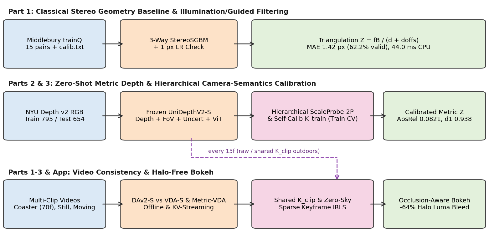
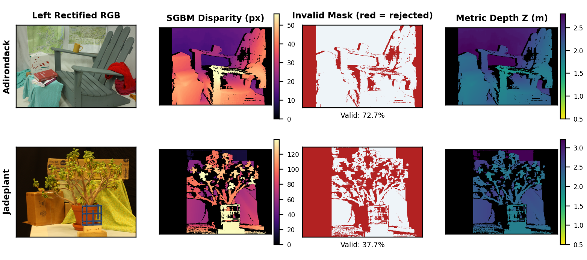
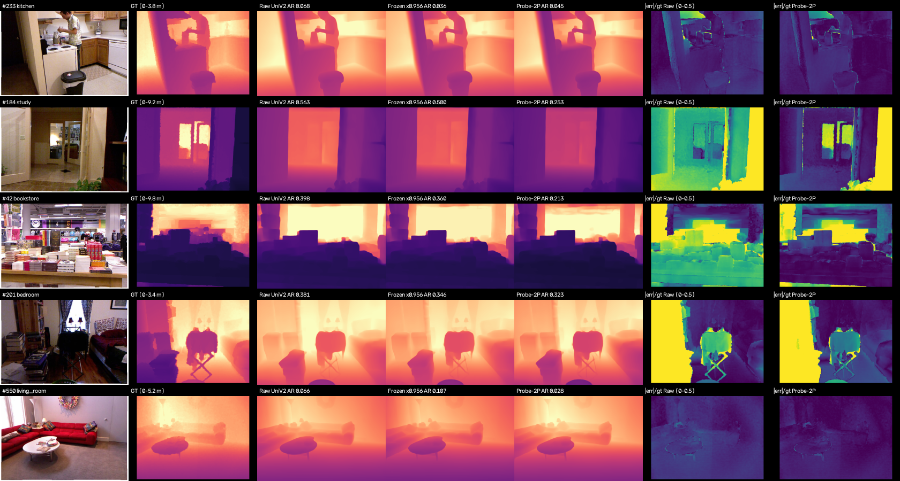
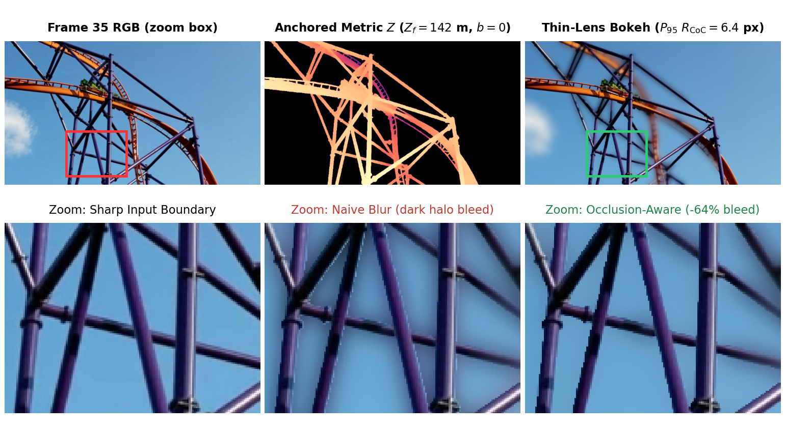

# Intro_to_CV_project_3

**Monocular Metric Depth Estimation and Video Consistency via Hierarchical Camera-Semantics Calibration**  
AIAA 3201 (Introduction to Computer Vision), Spring 2027  
**Authors:** Yuming Zhang (`50025933` / `1756882063@qq.com`) and Jiayang Liu (`50027216`)

This repository implements our complete geometry-and-learning pipeline following the final course brief (`Project_3__Monocular_Metric_Depth_Estimation_and_Video_Consistency.pdf`) under strict zero-test-leakage protocols:

- **Part 1 (Classical Stereo Geometry & Frame-wise Video Baseline)**: 3-way `StereoSGBM` + 1 px left-right consistency (LRC) check across all 15 Middlebury `trainingQ` rectified stereo pairs (`calib.txt` triangulation $Z = fB/(1000(d+d_{\text{offs}}))$, invalid occlusion visualization, empirical $O(Z^2)$ depth-error analysis, and LAB-CLAHE + OpenCV guided hole-filling ablation), alongside frame-wise `Depth Anything V2-Small` on `davis_rollercoaster.mp4`.
- **Part 2 (Zero-Shot Metric Depth & Temporally Consistent Video Depth)**: `UniDepthV2-Small` (`lpiccinelli/unidepth-v2-vits14`) evaluated zero-shot on the official 654-image NYU Depth v2 test split (`splits.mat`, Eigen crop, `480x640`, `[1e-3, 10]` m) with **zero test-set alignment**, plus `Video Depth Anything-Small` and official `Metric-VDA-Small` evaluated across offline 32-frame windowed mode and causal **attention-sink KV-cache streaming** under frozen clip-wide `[P2, P98]` normalization.
- **Part 3 (Hierarchical Camera-Semantics Metric Calibration)**: Diagnosing camera focal-length overestimation (`573.11 px` vs. Kinect `519.16 px`, $\rho = -0.534$), pixel uncertainty calibration ($\mathrm{AUSE} = 0.276$), and intra-room contrast compression ($\beta_0 = 1.058$) exclusively on the 795 NYU training images (`trainNdxs`), we build a progressive hierarchy from frozen global scaling ($s_{\mathrm{med}} = 0.9563$) to our strict Train-CV winner **4367-D `ScaleProbe-2P`** (`2.18 ms/img` zero-CPU-roundtrip GPU probe over FoV geometry, uncertainty quantiles, and frozen ViT/decoder tokens) and self-calibrated virtual rig intrinsics $\hat{K}_{\mathrm{train}}$.
- **Downstream Application (Shared-Camera Zero-Sky Metric Video & Halo-Free Thin-Lens Bokeh)**: Pooling clip intrinsics into shared $K_{\mathrm{clip}}$ and enforcing zero-sky intercept ($b=0$) in Huber-IRLS keyframe anchoring cuts outdoor OPW flicker by **$4.2\times$** over official `Metric-VDA-Small` (`0.1437 -> 0.0343`), restores `P95` background CoC blur from `2.06 px` to **`6.44 px`**, and drives an occlusion-aware background-visibility gather bokeh renderer reducing halo luma bleed by **`63.8%`** outdoors (`davis_rollercoaster`) and **`26.1%`** indoors (`moving.mp4`).

<p align="center">
  
</p>

---

## Headline Quantitative Results (Verified from Repo Outputs)

### 1. Part 1: Middlebury `trainingQ` Stereo & Filtering Ablation (`15` pairs)

| Variant (`src/stereo/sgbm.py`) | Valid MAE (px) ↓ | Valid Frac ↑ | `nocc` MAE (px) ↓ | `nocc` bad-2.0 ↓ | $Z$ MAE (cm) ↓ | $Z$ AbsRel ↓ | CPU ms/pair |
|---|---:|---:|---:|---:|---:|---:|---:|
| `3WAY (d>0 only, no LRC)` | 1.986 | **75.3%** | 10.01 | 33.5% | 6.32 | 2.22% | 16.6 |
| **`3WAY + 1px LRC (Course Baseline)`** | 1.420 | 62.2% | 10.01 | 33.5% | 4.65 | 1.60% | 44.0 |
| `3WAY + CLAHE + 1px LRC` | **1.322** | 62.1% | 10.34 | 34.2% | 4.54 | 1.58% | 49.7 |
| `3WAY + CLAHE + Guided Hole-Fill` | **1.322** | 62.1% | 4.44 | **29.1%** | 4.54 | 1.58% | 83.6 |
| `HH (8-path) + CLAHE + Guided Hole-Fill` | 1.328 | 62.8% | **4.44** | 29.2% | **4.50** | **1.51%** | 314.3 |

<p align="center">
  
</p>

### 2. Parts 2 & 3: NYU Depth v2 Official Test Split (`654` images, Eigen crop, zero test-set alignment)

| Camera Regime | Calibration Method (fit on NYU train `795` only) | AbsRel ↓ | RMSE (m) ↓ | SILog ↓ | $\delta_1$ ↑ | Hurt % ↓ | SI-BndF1 ↑ |
|---|---|---:|---:|---:|---:|---:|---:|
| RGB-only (`none`) | Raw `UniDepthV2-Small` ($s = 1$) | 0.1145 | 0.3988 | 9.73 | 0.8923 | — | 0.1130 |
| RGB-only (`none`) | + Frozen global median $s_{\mathrm{med}} = 0.9563$ | 0.1020 | 0.3892 | 9.73 | 0.8995 | 37.2% | 0.1130 |
| RGB-only (`none`) | + Centered global 2P power-law ($s_0 = 0.951, \beta_0 = 1.058$) | 0.1000 | 0.3850 | 9.56 | 0.9016 | 36.1% | 0.1190 |
| RGB-only (`none`) | + Analytic FoV coupling $\hat{s}(\hat{f}_i)$ (2 params) | 0.0944 | 0.3716 | 9.73 | 0.9247 | 34.6% | — |
| RGB-only (`none`) | + `ScaleProbe-1P` (global scale ridge) | 0.0848 | 0.3445 | 9.75 | 0.9351 | 28.3% | — |
| RGB-only (`none`) | + **`ScaleProbe-2P` (Primary 4367-D Train-CV winner, `+2.18 ms` GPU)** | **0.0821** | **0.3385** | **9.36** | **0.9383** | **27.5%** | **0.1198** |
| RGB-only (`none`) | + `ScaleProbe-2P` (*Leave-One-Scene-Out*, unseen room types) | 0.0853 | 0.3460 | 9.40 | 0.9350 | 29.2% | — |
| Self-calib. $\hat{K}_{\mathrm{train}}$ | Raw `UniDepthV2-Small` + virtual $\hat{K}_{\mathrm{train}}$ ($\hat{f}_x = 492.5$) | 0.0899 | 0.3597 | 9.49 | 0.9316 | 30.7%\* | 0.1181 |
| Self-calib. $\hat{K}_{\mathrm{train}}$ | + **`ScaleProbe-2P` (Primary 4367-D, fixed uncalibrated rig)** | **0.0816** | **0.3380** | **9.35** | **0.9384** | **26.6%\*** | **0.1223** |
| Hardware $K_{\mathrm{NYU}}$ | Raw `UniDepthV2-Small` + published Kinect $K_{\mathrm{NYU}}$ ($f_x = 518.9$) | 0.0922 | 0.3579 | 9.56 | 0.9263 | 30.0%\* | 0.1173 |
| Hardware $K_{\mathrm{NYU}}$ | + `ScaleProbe-2P` (known-camera upper ablation) | 0.0817 | 0.3381 | 9.35 | 0.9385 | 26.8%\* | 0.1228 |
| *Diagnostic ceiling* | *Test-GT per-image 1P scalar / 2P log-$L_2$ oracle (invalid as methods)* | *0.0601 / 0.0517* | *0.2971 / 0.2698* | *9.74 / 8.68* | *0.9495 / 0.9609* | *0.0% / 2.1%* | — |

*\*Measured relative to RGB-only raw baseline (`0.1145`). Standalone `CameraHead` latents ($\phi_{\mathrm{cam}}$, 1024-D) lead single-block ablations (`0.0859`), coupled-CV 4367-D reaches `0.0819`, Bayesian soft-fusion redeems noisy `KeypointRCNN` person-height overrides (`0.2243 -> 0.0852`), and 4P planar tilt oracle (`0.0504`) quantifies horizontal tilt limits.*

<p align="center">
  
</p>

### 3. Multi-Clip Video Consistency, Streaming KV-Cache & Halo-Free Bokeh (1× RTX 4090)

- **Relative Flicker & KV-Cache Streaming (`davis_rollercoaster.mp4`, `70` frames @ `24` fps)**:
  - `DAv2-Small` frame-wise (`fp32`): OPW `0.0170` (`36.3 ms/frame`, `415 MiB` VRAM base; `15.4 ms` / `343 MiB` matched `fp16`).
  - `VDA-Small` offline (32-frame window): OPW **`0.0143`** (`60.9 ms/frame`, `8016 MiB` VRAM).
  - `VDA-Small` **KV-cache streaming**: OPW **`0.0153`** (**`43.3 ms/frame`** [`-28.9%` latency], **`1219 MiB` VRAM** [`-84.8%` memory]).
- **Metric Multi-Clip Benchmark (`outputs/video_extended/multi_clip_benchmark.csv`)**:
  - `davis_rollercoaster` (`70f`): `UniDepthV2-S raw` OPW `0.0622` → `Metric-VDA-S` `0.1437` (`jitter2 = 2.645`) → **`VDA-S + K_clip (b=0)` `0.0343` offline / `0.0379` causal stream** (`4.2×` lower OPW than `Metric-VDA-S`; `RAFT-EMA` `0.0186`).
  - `still` (`100f`): `UniDepthV2-S raw` `0.0098` (`TAE 0.0110`) → **`VDA-S Stream + K_clip Causal` `0.0024` (`TAE 0.0034`)**.
  - `moving` (`100f`): Freezing `K_clip` cuts `UniDepthV2-S` OPW by **`44.5%`** (`0.0283 -> 0.0157`); **`VDA-S Stream + K_clip Causal` `0.0139`**.
- **Physical Bokeh Halo Elimination**: Shared-$K_{\mathrm{clip}}$ + zero-sky ($b=0$) restores `P95` CoC (`2.06 -> 6.44 px`), and visibility-weighted gather cuts luma halo bleed by **`63.8%`** on `davis_rollercoaster` and **`26.1%`** on `moving.mp4`.

<p align="center">
  
</p>

---

## Environment & Dependencies

Python 3.10+, PyTorch with CUDA, `torchvision`, `opencv-python`, `h5py`, `scipy`, `scikit-learn`, `matplotlib`, `imageio`, `imageio-ffmpeg`, `easydict`, `einops`.

```bash
export PYTHON=/path/to/env_cv/bin/python
```

Clone upstream model repositories into `third_party/` (not tracked in git):

```bash
mkdir -p third_party
git clone --depth 1 https://github.com/DepthAnything/Depth-Anything-V2.git third_party/Depth-Anything-V2
git clone --depth 1 https://github.com/DepthAnything/Video-Depth-Anything.git third_party/Video-Depth-Anything
git clone --depth 1 https://github.com/lpiccinelli-eth/UniDepth.git third_party/UniDepth
```

### Checkpoints & Data

```bash
mkdir -p third_party/Depth-Anything-V2/checkpoints third_party/Video-Depth-Anything/checkpoints
curl -L -o third_party/Depth-Anything-V2/checkpoints/depth_anything_v2_vits.pth \
  https://huggingface.co/depth-anything/Depth-Anything-V2-Small/resolve/main/depth_anything_v2_vits.pth
curl -L -o third_party/Video-Depth-Anything/checkpoints/video_depth_anything_vits.pth \
  https://huggingface.co/depth-anything/Video-Depth-Anything-Small/resolve/main/video_depth_anything_vits.pth
curl -L -o third_party/Video-Depth-Anything/checkpoints/metric_video_depth_anything_vits.pth \
  https://huggingface.co/depth-anything/Metric-Video-Depth-Anything-Small/resolve/main/metric_video_depth_anything_vits.pth

bash scripts/download_benchmarks.sh   # Middlebury trainQ + GT, NYU labeled .mat
```

Place the official `splits.mat` in `data/nyu/splits.mat`. `UniDepthV2-Small` (`lpiccinelli/unidepth-v2-vits14`) and `RAFT-Small` (`torchvision`) download automatically on first run.

---

## Official Video Depth Anything CLI & Reproducing All Experiments

Upstream `Video-Depth-Anything` relative/metric streaming commands:

```bash
cd third_party/Video-Depth-Anything
$PYTHON run.py --video assets/example_videos/davis_rollercoaster.mp4 --encoder vits --max_len 100 --max_res 640
$PYTHON run_streaming.py --video assets/example_videos/davis_rollercoaster.mp4 --encoder vits --max_len 100 --max_res 640
```

Project pipeline scripts (`scripts/`):

```bash
# 1. Part 1: Middlebury StereoSGBM + 1 px LRC + metric Z + CLAHE/Guided ablation -> outputs/stereo/
$PYTHON scripts/run_middlebury_sgbm.py

# 2. Parts 2 & 3: Cache UniDepthV2 & DAv2 predictions and rich internal features (train 795 + test 654)
$PYTHON scripts/cache_nyu_unidepth.py --camera none
$PYTHON scripts/cache_nyu_unidepth.py --camera nyu
$PYTHON scripts/cache_nyu_unidepth_rich.py

# 3. Baseline global scalar & hierarchical calibration (ScaleProbe-2P, K_train, LOSO, AUSE, Bayesian prior)
$PYTHON scripts/eval_nyu_global_scale.py          # -> outputs/nyu_global_scale/
$PYTHON scripts/eval_nyu_hierarchical.py          # -> outputs/nyu_hierarchical/
$PYTHON scripts/make_nyu_figures.py               # baseline failure panels -> paper/figs/

# 4. Multi-clip video consistency, Metric-VDA-S, RAFT-EMA, shared-K_clip b=0 anchoring & halo-free bokeh
$PYTHON scripts/run_video_compare.py              # -> outputs/video/
$PYTHON scripts/run_video_extended.py             # -> outputs/video_extended/

# 5. Regenerate all publication vector PDF & PNG figures -> paper/figs/
$PYTHON scripts/make_all_publication_figures.py

# 6. Build CVPR English report (paper/main.pdf) & Chinese companion report (paper/Project_3_中文版报告.pdf)
cd paper && pdflatex main.tex && bibtex main && pdflatex main.tex && pdflatex main.tex
uv run --no-project --with python-docx==1.1.2 python paper/build_report_zh.py
libreoffice --headless --convert-to pdf --outdir paper paper/Project_3_中文版报告.docx
```

---

## Repository Layout

- `src/stereo/`: Middlebury calibration parser (`middlebury.py`) and 3-way / HH `StereoSGBM` + 1 px LRC + LAB-CLAHE + pure-OpenCV guided hole-filling (`sgbm.py`).
- `src/eval/`: NYU Depth v2 Eigen-crop protocol incl. SILog (`nyu.py`), scale-invariant boundary F1 (`boundary.py`), and video consistency metrics (`video.py`).
- `src/calibration/`: Frozen global scalar estimators (`global_scale.py`), hierarchical `ScaleProbe-2P`, `GPUScaleProbe`, planar 4P oracle & virtual camera self-calibration (`hierarchical.py`), and Bayesian/keypoint object-height priors (`scale.py`).
- `src/fusion/`: Optical-flow `RAFT-EMA` video stabilizer (`flow.py`) and streaming/offline shared-$K_{\mathrm{clip}}$ zero-sky Huber-IRLS metric video anchoring (`metric_video.py`).
- `src/application/`: Relative-disparity blur (`blur.py`), occlusion-aware one-sided thin-lens bokeh renderer + halo-bleeding evaluator (`physical_bokeh.py`), and auxiliary obstacle/point-cloud tools.
- `paper/`: Camera-ready 8-page CVPR LaTeX source (`main.tex`, `main.bib`, `main.pdf`), dynamic Chinese companion generator (`build_report_zh.py`, `Project_3_中文版报告.pdf`), and publication figures (`figs/`).
